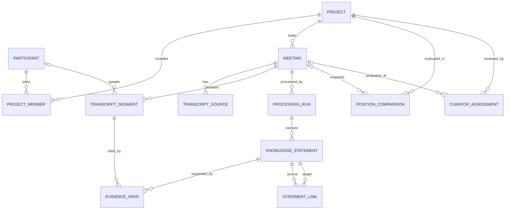

# Архитектура и схема данных

## Схема сущностей

`MEETING` — запись созвона. `KNOWLEDGE_STATEMENT` — атомарное извлечённое высказывание или событие. `EVIDENCE_SPAN` — точная привязка к одному или нескольким фрагментам транскрипта. Сравнения и оценки куратора не переписывают исходные высказывания.

Поля ниже задают логическую схему. Для всех таблиц нужны первичные ключи и `created_at`; для изменяемых справочных записей — также `updated_at`. Внешние ключи должны проверяться базой.

## Организация проекта и созвонов

| Таблица | Назначение и основные поля |
|---|---|
| `projects` | `id`, `external_key`, `name`, `stage`, `status`, `started_at`, `ended_at`. Проект — единица обзора куратора. |
| `participants` | `id`, `display_name`, `external_key` (если есть). Не хранить лишние персональные данные. |
| `project_members` | `project_id`, `participant_id`, `role`, `valid_from`, `valid_to`. История состава команды и роли заказчика/партнёра. |
| `meeting_protocols` | `id`, `name`, `version`, `description`. Протокол может влиять на то, какие темы ожидаемо обсуждаются. |
| `meetings` | `id`, `project_id`, `held_at`, `protocol_id` (nullable), `project_stage`, `transcript_status`. Стадия фиксируется на дату созвона, а не только берётся из текущего состояния проекта. |
| `transcript_sources` | `id`, `meeting_id`, `storage_uri`, `checksum`, `language`, `transcription_provider`, `created_at`, `retention_until` (nullable). Доступ к исходному медиа ограничить отдельно. |
| `transcript_segments` | `id`, `meeting_id`, `sequence_no`, `start_ms`, `end_ms`, `speaker_id` (nullable), `speaker_confidence`, `text_original`, `text_cleaned` (nullable). `text_original` сохраняет доказательство; очищенный текст нужен для обработки. |

Если транскрипт уже сегментирован, сохранять границы и таймкоды источника. Если границы сегментов меняются на этапе очистки, хранить исходные и обработанные сегменты раздельно либо явно версионировать преобразование.

## Обработка и извлечённые знания

| Таблица | Назначение и основные поля |
|---|---|
| `processing_runs` | `id`, `meeting_id`, `status`, `pipeline_version`, `model_name`, `prompt_version`, `started_at`, `finished_at`, `error_code`. Позволяет повторить обработку и понять происхождение результата. |
| `knowledge_statements` | `id`, `project_id`, `meeting_id`, `speaker_id` (nullable), `speaker_attribution_status`, `dimension`, `statement_type`, `text_verbatim`, `normalized_text` (nullable), `position_state`, `confidence`, `evidence_status`, `review_status`, `processing_run_id`. Одна строка — один смысловой факт/высказывание, а не целое резюме созвона. |
| `evidence_spans` | `id`, `statement_id`, `segment_id`, `char_start` (nullable), `char_end` (nullable), `quote_text` (nullable). У высказывания может быть несколько подтверждающих фрагментов. `evidence_status` указывает, есть ли проверяемое подтверждение или требуется ручная проверка. |
| `statement_links` | `id`, `from_statement_id`, `to_statement_id`, `relation_type`, `confidence`, `processing_run_id`. Варианты связей: `supports`, `contradicts`, `responds_to`, `refines`, `supersedes`, `decides_on`, `rejects`. |
| `meeting_topic_coverage` | `meeting_id`, `dimension`, `coverage_state`, `confidence`, `processing_run_id`. Показывает, обсуждалась ли тема в созвоне, а не только была ли найдена позиция участника. |

Рекомендуемые значения `dimension`: `goal`, `consumer`, `scenario`. Для сценария можно хранить отдельное поле `scenario_change` или тип события, чтобы отличать текущее описание сценария от предложения его изменить.

Рекомендуемые `statement_type`: `position`, `proposal`, `argument`, `decision`, `rejection`, `open_question`, `scenario_change`. `dimension` отвечает на вопрос «о чём», `statement_type` — «что произошло в разговоре».

`position_state` — состояние высказывания, а не оценка всей встречи:

- `stated` — участник выразил позицию;
- `agrees` / `disagrees` — явное согласие или несогласие с указанным высказыванием;
- `explicit_no_position` — участник явно сказал, что пока не имеет позиции;
- `unclear` — содержание или авторство не удалось уверенно определить.

Отсутствие строки о позиции не означает несогласия, молчания или отсутствия участника. Если тема не упоминалась, это отражает `meeting_topic_coverage`; если говорящий просто не высказался, не создавать для него фиктивную позицию.

Для `speaker_attribution_status` использовать как минимум `identified`, `unknown`, `ambiguous`; для `evidence_status` — `supported`, `missing`, `needs_review`. Это позволяет явно учитывать строки без уверенного автора или подтверждающего фрагмента, не выдавая их за проверенные знания.

## Сравнение и обратная связь куратора

| Таблица | Назначение и основные поля |
|---|---|
| `position_comparisons` | `id`, `project_id`, `meeting_id`, `dimension`, `comparison_status`, `severity`, `explanation`, `algorithm_version`, `confidence`, `created_at`. Снимок сравнения на конкретном созвоне и версии алгоритма. |
| `comparison_participants` | `comparison_id`, `participant_id`, `statement_id` (nullable), `included`, `exclusion_reason`. Показывает, какие позиции участвовали в сравнении и почему участник мог быть исключён. |
| `curator_assessments` | `id`, `project_id`, `meeting_id` (nullable), `dimension` (nullable), `assessment`, `attention_needed`, `reason`, `assessor_id`, `created_at`. Ручная оценка для проверки качества сигналов. |
| `project_attention_events` | `id`, `project_id`, `created_at`, `reason_code`, `status`, `resolved_at`, `resolution_note`, `source_comparison_id` (nullable). История причины попадания проекта в список внимания и решения куратора. |
| `outcome_assessments` | `id`, `project_id`, `outcome_type`, `outcome_date`, `assessment`, `source`, `notes`. Позволяет сопоставлять ранние сигналы с проблемами на демо/приёмке. |

Автоматическая оценка системы, решение куратора и фактический результат проекта — разные данные. Они не должны автоматически копироваться друг в друга.
